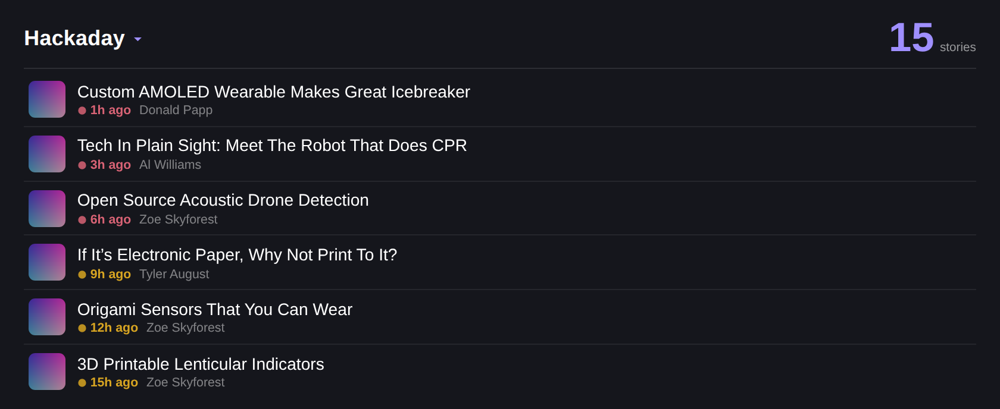

# RSS Reader — iCUE Widget for Xeneon Edge

A glanceable, **My Day**-style RSS/Atom reader for the CORSAIR Xeneon Edge. Dark theme, article thumbnails, relative-time chips, and per-feed tabs — designed to sit alongside [ClickUp Tasks](https://github.com/joshuawowk/icue-widget-clickup) and share its design language.



## Why this exists

A widget runs inside a browser engine, so it can only read a feed the site's server lets it read. Most feeds — **Hackaday included** — send no `Access-Control-Allow-Origin` header, so a direct fetch is blocked by CORS no matter which feed path you point at. `hackaday.com/feed/`, `/rss.xml` and `/blog/feed/` all fail for the same reason, and swapping between them changes nothing.

The usual workaround is a single public CORS proxy, which becomes a single point of failure the moment that service goes down. This widget instead tries a **chain of routes** and uses the first that returns stories:

| # | Route | Notes |
|---|-------|-------|
| 1 | **Direct fetch** | Works for feeds that send CORS headers (NYT, WIRED, CNBC, Reddit, GitHub…) |
| 2 | **WordPress.com REST API** | First-party, CORS-enabled, unlimited. Covers Hackaday and a large share of the blog web. Ahead of the proxy on purpose: it honours Max Stories, while the site's RSS file usually stops at 10 items |
| 3 | **Custom proxy** | Yours, if configured — see below |
| 4 | **rss2json** | Public JSON bridge |
| 5 | **allorigins** (`/raw`) | Public XML relay |
| 6 | **feedrapp** | Public JSON bridge |
| 7 | **codetabs** | Public XML relay |
| 8 | **allorigins** (`/get`) | Wrapped-XML fallback |

For Hackaday the winning route is **#2** — Hackaday runs on WordPress, which publishes an official JSON API that *does* send CORS headers. No third-party proxy is involved and there is no rate limit to hit.

Open the feed switcher (tap the header) to see which route actually answered: it reads `via wordpress.com • 4m ago` under the chips.

The widget understands RSS 2.0, Atom, RDF, and the JSON shapes each bridge returns, normalising all of them to the same story model.

## Features

- **Up to 5 feeds**, as tabs or merged into one date-sorted stream
- **Interactive (touch)**:
  - Tap the **header** → feed switcher chips
  - Tap a story → detail view with the article image, author, tags, and summary
  - Tap **Open** → launches the article in your desktop browser
  - The story list scrolls by touch when it overflows
- **Thumbnails** from `media:thumbnail`, `media:content`, `enclosure`, WordPress featured images, or the first inline `` — with a graceful RSS-glyph placeholder when an image is missing or hotlink-blocked
- **Relative time chips**: pink under 6h, amber same-day, muted beyond
- **Offline resilience**: keeps showing the last good stories with an amber dot if every route fails
- **Excerpt cleanup**: strips `…read more`, `Continue reading →` and `The post … appeared first on …` boilerplate
- **Responsive**: all Xeneon Edge slot sizes — S/M/L/XL, horizontal (multi-column on L/XL) and vertical
- **Personalization**: text/accent/background colors, background image with glass blur, transparency

## Installation

### With the iCUE Widget CLI

```
icuewidget validate icue-widget-rss
icuewidget package icue-widget-rss
```

Double-click the produced `.icuewidget` file to install into iCUE (5.44+).

### Manual (development)

Copy this folder into your iCUE widgets directory and restart iCUE.

## Settings

| Setting | Type | Default | Description |
|---------|------|---------|-------------|
| Feed URL 1–5 | text | Hackaday, WIRED | Any RSS/Atom feed URL (must be `https://`), optionally named: `Label\|https://…` |
| Title | text | empty | Blank = use the feed's own name |
| Feed Mode | dropdown | Tabs | One feed at a time, rotate through the feeds every 15 min, or merge them all by date |
| Thumbnails | dropdown | Show | Turn off for a denser text-only list |
| Max Stories | slider | 15 | 3–40 |
| Refresh Interval | slider | 15 min | 5–120 min |
| Custom Proxy URL | text | empty | Optional — see below. `https://` anywhere, or `http://` on a private address (LAN, localhost, Tailscale CGNAT) |

### Naming a feed

A feed slot takes `Label|https://…` as well as a bare URL. The label replaces the
title the feed reports, in the header and on the switcher chip. This matters for
feeds built out of a site search — a BLOX/TownNews newspaper calls itself
`www.example.com - RSS Results in news/section of type article`:

```
Valley Breeze|https://www.valleybreeze.com/search/?f=rss&t=article&c=news/north_smithfield_and_blackstone&l=15&s=start_time&sd=desc
```

### Local newspapers (BLOX / TownNews)

Most small US papers run BLOX and expose no `<link rel="alternate">`, but the
search endpoint speaks RSS:

```
https://<paper>/search/?f=rss&t=article&c=<section/subsection>&l=15&s=start_time&sd=desc
```

`c=` is the section path from the site URL (`/news/north_smithfield_and_blackstone/`
→ `c=news/north_smithfield_and_blackstone`); drop it for every article, add `*`
for a section plus its children. Keep `l=` at 10–15 — public relays choke on
larger BLOX feeds. These sites send **no** `Access-Control-Allow-Origin` header,
rss2json's fetcher is refused outright, and feedrapp answers maybe half the time,
so a paper like this is the case the custom proxy exists for.

### Custom proxy

If you'd rather not depend on public relays, point this at your own. Three forms are accepted:

```
https://proxy.example.net/fetch?url={url}    # {url} is replaced with the URL-encoded feed
https://proxy.example.net/fetch/{raw}        # {raw} is replaced with the feed URL as-is
https://proxy.example.net/fetch?url=         # trailing form; the encoded feed URL is appended
```

The response may be raw feed XML **or** any of the JSON shapes above — the widget sniffs the format. A minimal Cloudflare Worker is enough:

```js
export default {
  async fetch(req) {
    const url = new URL(req.url).searchParams.get('url');
    if (!url) return new Response('missing url', { status: 400 });
    const upstream = await fetch(url, { headers: { 'User-Agent': 'rss-widget/1.0' } });
    return new Response(upstream.body, {
      status: upstream.status,
      headers: {
        'Content-Type': upstream.headers.get('Content-Type') || 'application/xml',
        'Access-Control-Allow-Origin': '*',
        'Cache-Control': 'public, max-age=300'
      }
    });
  }
};
```

## Testing — run this before you ever install a build

`icuewidget validate` only checks packaging. It cannot tell you whether the widget
will actually *run*, and every failure mode below is silent on the panel: the widget
sits on its loading spinner with no error anywhere.

```
npm install          # once — pulls Playwright
npm test             # static checks + the widget running under iCUE's real bootstrap
npm run test:live    # same, but against the live internet instead of tools/fixtures
npm run test:selftest# proves the harness still catches known-bad builds
```

`tools/icue-test.js` does two passes:

**Static** — the checks `icuewidget validate` does not make: declarations colliding
with iCUE-injected globals, `icueEvents` wired the wrong way, strict mode, ES modules,
external `<script src>`, sliders missing `data-step`, `media-selector` missing
`data-filters`, and `tr()` keys absent from `translation.json`.

**Runtime** — loads `index.html` in Chromium behind a replica of iCUE's Qt bridge,
injecting `tools/icue-bootstrap.js` — iCUE's **verbatim** bootstrap, captured from a
live instance — as a document-start script, exactly as iCUE does. It then asserts
`onICUEInitialized` actually fires, the widget paints at all four Xeneon Edge slot
sizes, a settings change propagates through `onDataUpdated`, touch interaction works,
and the fetch chain falls through when a route dies.

`tools/harness-selftest.js` reintroduces each bug that has really shipped and confirms
the harness fails on it. A harness that cannot fail is not a test.

## How iCUE actually runs a widget

Four rules, all learned by shipping builds that broke. iCUE injects a bootstrap script
(reproduced verbatim in `tools/icue-bootstrap.js`) *before* the widget's own scripts.

**1. `icueEvents` must be a bare assignment.** The bootstrap declares
`let icueEvents = {onDataUpdated: null, onICUEInitialized: null, onUpdateRequested: null}`
at global scope and reads the handlers back off it.

```js
icueEvents = { onICUEInitialized: init, onDataUpdated: update };   // correct
window.icueEvents = { ... };   // SILENT no-op — a global `let` is not a window property
let icueEvents = { ... };      // SyntaxError — kills the entire <script> before it runs
```

**2. Never declare anything sharing an injected global's name.** The bootstrap
`let`-declares `uniqueId`, `tick_offset`, `tick_start`, `iCUE_initialized`, `icueEvents`,
**and one per `x-icue-property`**. A top-level `function maxItems()` beside iCUE's
`let maxItems` is a redeclaration SyntaxError that discards the whole script. This
widget wraps everything in an IIFE so that collision is structurally impossible.

**3. Read properties through the `Function()` fallback.** A global `let` is invisible to
`window[name]`, so `getIcueProperty` must fall through to
`Function('return typeof ' + name + ' !== "undefined" ? ' + name + ' : undefined')()`.

**4. First paint must come from `onICUEInitialized`, and `iCUE_initialized` is a race.**
The initial `applyData()` runs while `iCUE_initialized` is still `false`, so
`onDataUpdated` never fires for the first load — a widget that only paints there waits
forever. And a single synchronous read of `iCUE_initialized` can be a false negative
even inside iCUE, so this widget polls across a ~2s grace window before concluding it
is running in a plain browser.

Also: QtWebEngine silently blocks external `<script src>` over `file://` — the tag
appears in the DOM and never executes — so all JS here is inlined, MediaViewer included.
And a `window.onerror` overlay paints any future failure onto the panel instead of
leaving a silent spinner.

## Troubleshooting

A feed that shows the amber dot has exhausted every route. Open the widget's dev console — each attempt is logged with the reason it failed (`timed out`, `HTTP 403`, `not valid XML`, …), which usually points straight at the cause.

Feeds that need an `Authorization` header or a session cookie will not work through the public routes; use a custom proxy that adds the credential server-side.

## License

MIT — see [LICENSE](LICENSE).
